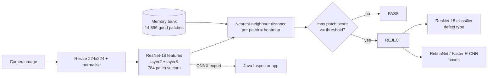
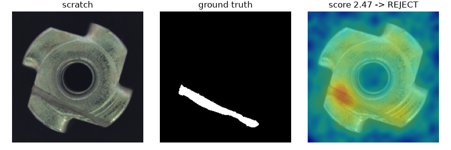
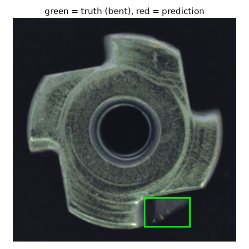
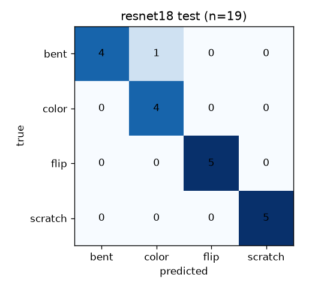
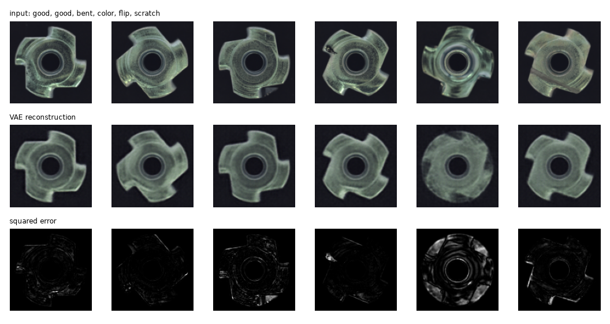
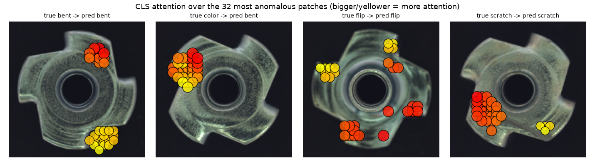
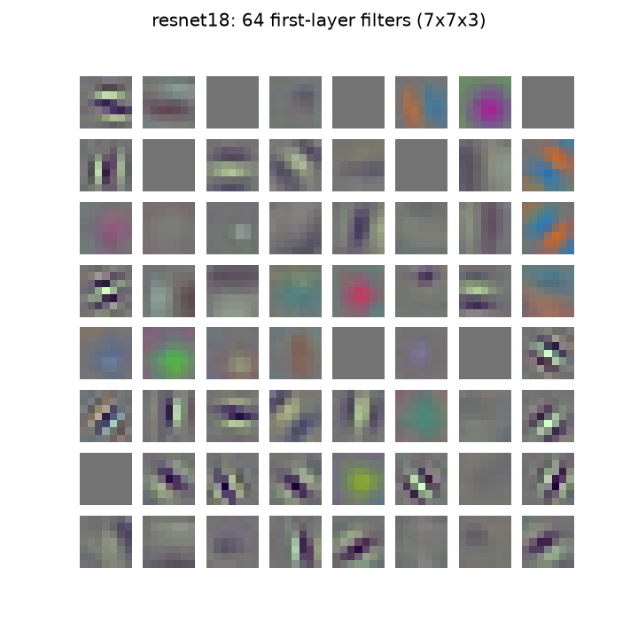

# Industrial Surface Defect Inspection (MVTec AD `metal_nut`)

Deep Learning PBL project. The system looks at a photo of a metal nut and decides **PASS / REJECT**,
shows **where** the defect is (heatmap), names the **defect type** (bent / color / flip / scratch) and can
draw **boxes** around defects. The main detector, **PatchCore**, learns only from *good* nuts, so it can flag
defects it has never seen. The final model also runs as a **Java application** (ONNX Runtime).

> Research prototype on MVTec AD (licence CC BY-NC-SA 4.0, non-commercial). Not validated for production use.

## Pipeline



## Data split (no leakage, seed 42, `splits.json`)

| split | content | used for |
|---|---|---|
| train_good | 190 good | PatchCore memory bank, VAE |
| sup_train | 56 defects | classifier, detectors, report transformer |
| val | 26 good + 18 defects | choosing thresholds and settings |
| test | 26 good + 19 defects | final numbers **only** (never used for tuning) |

## Results (test set)

### 1. Anomaly detection (PASS / REJECT)
Threshold chosen on the validation set (maximum F1).

| model | image AUROC | pixel AUROC | defects caught | good falsely rejected | F1 | ms / image (Python, MPS) |
|---|---|---|---|---|---|---|
| PatchCore ResNet-18 | 0.974 | 0.993 | 18/19 | 1/26 | 0.947 | 29.5 |
| PatchCore ResNet-18 noise-robust | 0.962 | 0.992 | 18/19 | 1/26 | 0.947 | 27.5 |
| PatchCore WideResNet-50 | 0.998 | 0.995 | 16/19 | 0/26 | 0.914 | 58.6 |
| VAE reconstruction error | 0.666 | – | – | – | – | – |

### 2. Defect type classification (4 classes)
| model | params (M) | test accuracy | test macro-F1 | ms / image |
|---|---|---|---|---|
| ResNet-18 | 11.18 | 0.947 | 0.944 | 23.1 |
| GoogLeNet | 5.6 | 0.947 | 0.944 | 50.1 |
| Report Transformer | – | 0.895 | 0.871 | – |

### 3. Defect boxes (detectors)
| model | mAP@50 | AP bent | AP color | AP flip | AP scratch | ms / image |
|---|---|---|---|---|---|---|
| Faster R-CNN | 0.820 | 0.900 | 0.750 | 1.000 | 0.630 | 157.9 |
| RetinaNet | 0.549 | 0.603 | 0.268 | 1.000 | 0.324 | 86.5 |

### 4. Java app (ONNX Runtime) and robustness
Java and Python give the same PASS/REJECT decision on 45/45 test images.

| condition | original: caught | original: false rejects | noise-robust: caught | noise-robust: false rejects |
|---|---|---|---|---|
| clean | 18/19 | 1/26 (3.8%) | 18/19 | 1/26 (3.8%) |
| brighter 20% | 18/19 | 1/26 (3.8%) | 18/19 | 1/26 (3.8%) |
| darker 20% | 18/19 | 1/26 (3.8%) | 18/19 | 0/26 (0.0%) |
| Gaussian noise σ=0.03 | 18/19 | **14/26 (53.8%)** | **15/19** | **0/26 (0.0%)** |

**Noise fix.** The original model rejected 14 of 26 good nuts when noise was added. Fix: put one noisy copy
of every good training image into the memory bank (same bank size), so "good + noise" counts as normal. The
setting was chosen on the **validation set only** from 10 candidates (input blur 0–2 × 0/1 noisy copies), see
`experiments/noise_robustness/val_grid.csv`. Honest result: noise false rejects 14 → 0, but missed defects
under noise 1 → 4 (subtle colour and scratch defects look similar to noise). Details:
`experiments/noise_robustness/before_after.md`.

## Figures

| PatchCore heatmap (scratch) | Detector boxes | Classifier confusion matrix |
|---|---|---|
|  |  |  |

| VAE reconstructions | Transformer attention | CNN first-layer filters |
|---|---|---|
|  |  |  |

More: `experiments/*/figures/`, `report_figs/`, `java/out/`.

## Project structure

```
splits.json                 fixed leakage-safe data split (do not change)
src/prepare_data.py         verify dataset, find duplicates, create splits.json
src/patchcore.py            PatchCore anomaly detection (+ noise-robust options)
src/noise_robustness.py     choose the noise fix on the validation set
src/classifier.py           ResNet-18 / GoogLeNet defect-type classifier
src/detector.py             RetinaNet / Faster R-CNN boxes
src/vae.py                  variational autoencoder (generative model)
src/report_transformer.py   small transformer that writes an inspection report
src/export_onnx.py          export PatchCore to ONNX + memory bank for Java
app/streamlit_app.py        demo app: Inspection, Noise demo, Results, Pipeline
java/app/Inspector.java     deployed inspection app (ONNX Runtime Java)
java/src/main/java/dl/      deep learning fundamentals from scratch in Java
deploy/, deploy_robust/     files the Java app loads (original / noise-robust model)
experiments/                metrics, logs and figures of every run
```

## How to run

### 0. Setup (once)
```bash
python3.11 -m venv .venv
source .venv/bin/activate
pip install -r requirements.txt
```
- Dataset: download MVTec AD `metal_nut` from https://www.mvtec.com/company/research/datasets/mvtec-ad
  and unpack it so that `data/mvtec/metal_nut/train`, `test`, `ground_truth` exist.
- Java: install Java 25 and put `onnxruntime-1.23.0.jar` (Maven Central,
  `com.microsoft.onnxruntime:onnxruntime:1.23.0`) into `lib/`.

The `.pt` model files are not in the repository (too large). Re-create them with the training commands below.

### 1. Data split
```bash
python src/prepare_data.py --root data/mvtec/metal_nut --out splits.json   # splits.json is already included
```

### 2. Train / evaluate the models (Python)
```bash
python src/patchcore.py --backbone resnet18 --out experiments/patchcore_r18
python src/patchcore.py --backbone wide_resnet50_2 --out experiments/patchcore_wrn50
python src/classifier.py --arch resnet18  --out experiments/cls_resnet18
python src/classifier.py --arch googlenet --out experiments/cls_googlenet
python src/detector.py --model retinanet  --out experiments/det_retinanet
python src/detector.py --model fasterrcnn --out experiments/det_fasterrcnn
python src/vae.py
python src/report_transformer.py
```

### 3. Noise fix
```bash
python src/noise_robustness.py      # ~20 min; validation only -> experiments/noise_robustness/
python src/patchcore.py --noisy_copies 1 --aug_noise 0.03 --coreset_cpu --out experiments/patchcore_r18_robust
```

### 4. Export for Java and run the Java app
```bash
python src/export_onnx.py                                                              # -> deploy/
python src/export_onnx.py --pc_dir experiments/patchcore_r18_robust --out deploy_robust  # -> deploy_robust/

javac -cp lib/onnxruntime-1.23.0.jar -d target/app java/app/Inspector.java
java -cp target/app:lib/onnxruntime-1.23.0.jar Inspector evaluate                  # original  -> experiments/java_app/
java -cp target/app:lib/onnxruntime-1.23.0.jar Inspector evaluate deploy_robust    # robust    -> experiments/java_app_robust/
java -cp target/app:lib/onnxruntime-1.23.0.jar Inspector inspect data/mvtec/metal_nut/test/scratch/020.png
```

### 5. Java fundamentals (from scratch, no libraries)
```bash
cd java
javac -d target/classes src/main/java/dl/*.java
java -cp target/classes dl.Demo3Sandbox     # maths sandbox
java -cp target/classes dl.Demo4Neurons     # neurons, MLP, backpropagation
java -cp target/classes dl.Demo5Training    # optimizers, initialisation, generalisation
java -cp target/classes dl.Demo6Rules       # learning rules + Hopfield network
```
Figures are written to `java/out/`.

### 6. Demo app
```bash
streamlit run app/streamlit_app.py
```
Pages: **Inspection** (one image → PASS/REJECT, heatmap, type, boxes), **Noise demo** (slider adds noise,
original vs robust model), **Results** (all tables, read live from `experiments/`), **Pipeline** (diagram).

## Limitations
- Small test set (45 images): one image changes a rate by 2–4 percentage points.
- The noise fix is tuned for σ = 0.03 Gaussian noise; other noise types and levels were not tested.
- The defect-type classifier only knows the 4 defect types seen in training.
